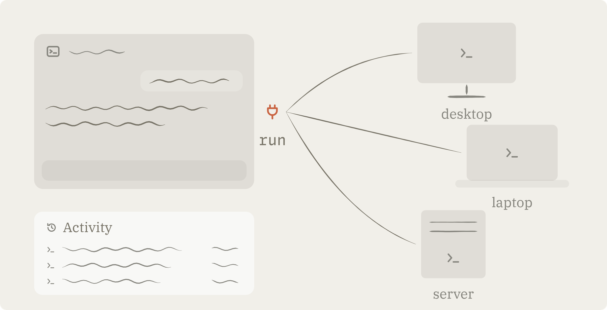
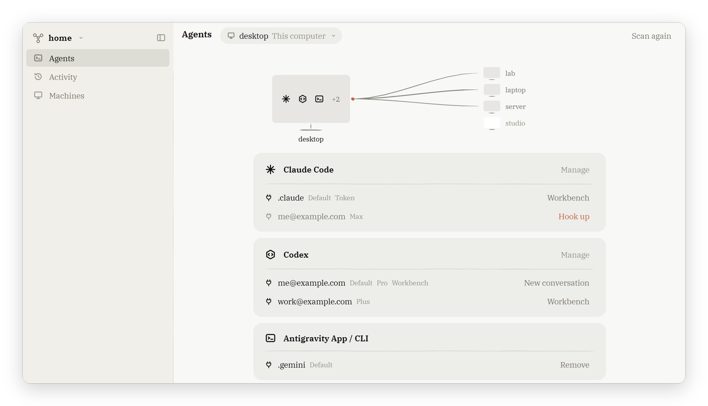
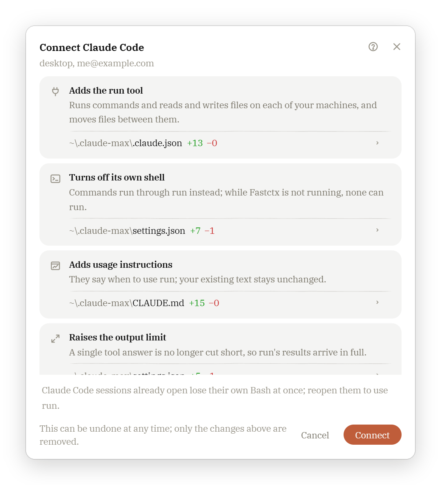
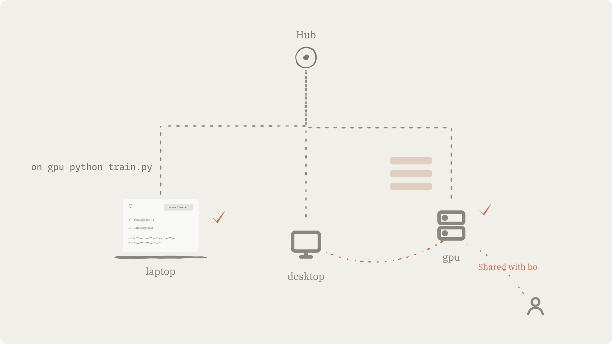
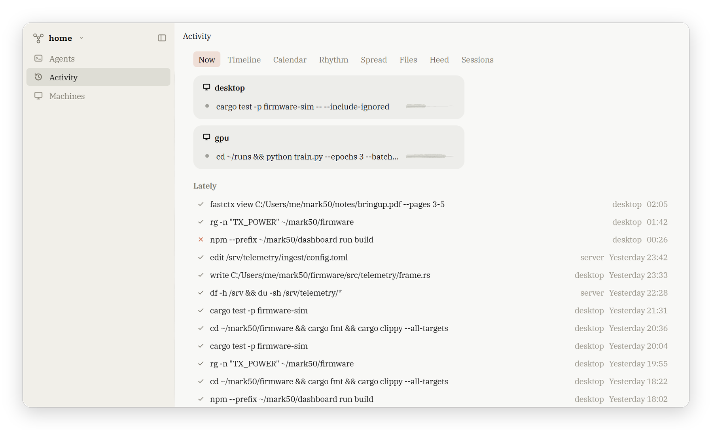
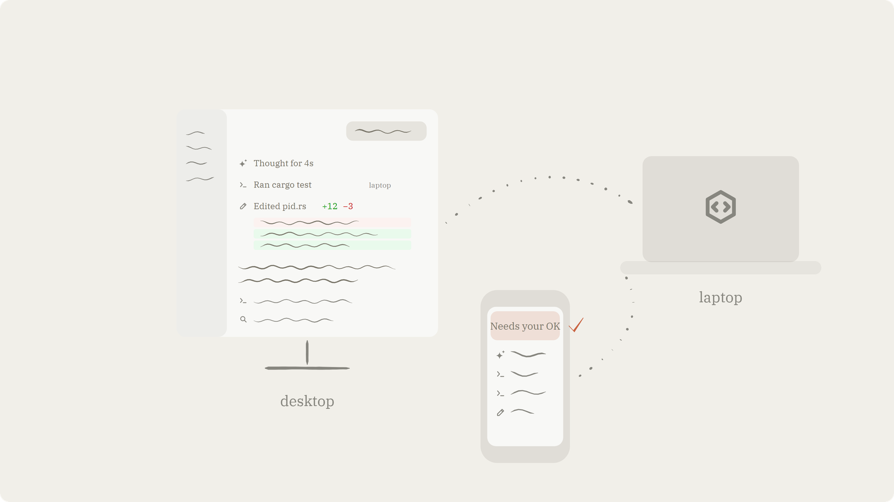

<p align="center">
  
</p>

<h1 align="center">Fastctx</h1>

<p align="center">Let the AI agents you already use work across every one of your machines.</p>

<p align="center">
  <a href="#installation">Download</a> · <a href="README.zh-CN.md">中文</a> · <a href="LICENSE-APACHE">Apache-2.0</a>
</p>

<picture>
  <source media="(prefers-color-scheme: dark)" srcset="docs/readme/en/hero-dark.png">
  
</picture>

## What Fastctx is

Fastctx is an MCP tool. When you connect it to the agents you already use—17 supported agents, including Claude Code, Codex, and Cursor—the agent gets a single tool named `run`. With `run`, it can execute commands, view and edit files on any of your machines, copy files between machines, and leave long-running jobs in the background.

- You keep working in your own agent without changing tools or habits.
- Your machines connect through your own Hub across Windows, macOS, and Linux, without needing public IP addresses.
- Everything an agent does through Fastctx on a machine is recorded in that machine's Activity.
- Available as a desktop app (Windows, macOS, Linux), an Android app, and a CLI.
- Data between machines travels only through your own Hub (or directly between machines), never through third-party servers.

<picture>
  <source media="(prefers-color-scheme: dark)" srcset="docs/readme/en/agents-dark.png">
  
</picture>

## Connect an agent

When you open Fastctx, it detects the agents installed on your computer and their sign-ins. Before you click **Connect**, a window shows what will change: one card per modification, with the exact file diff underneath.

Connecting does three things:

1. **Adds the `run` tool**: Registers the Fastctx MCP server in the agent's config file, such as `config.toml` for Codex or `.claude.json` for Claude Code.
2. **Adds usage instructions**: Writes a short section into the agent's global instruction file (such as `AGENTS.md` or `CLAUDE.md`) explaining when to use `run`.
3. **Turns off its own shell**: Routes command execution through `run`. For 8 agents whose built-in shell cannot be turned off (see the table below), both remain available, and only commands run through `run` are recorded in Activity.

- **Remove**: Removes only what Fastctx wrote and restores modified values. Your own content in those files stays untouched.
- **Updates**: When Fastctx upgrades, it updates the sections it wrote to match the new version. If those sections were edited manually, Fastctx backs up the file before replacing them.
- **Boundaries**: Fastctx does not wake the agent, sends no request to its vendor on its behalf, and does not read its conversations, quotas, or usage. It reads only the account identifiers in the sign-in directory to tell multiple sign-ins apart on the same computer.

<p align="center">
  <picture>
    <source media="(prefers-color-scheme: dark)" srcset="docs/readme/en/connect-dark.png">
    
  </picture>
</p>

| Built-in shell | Agents |
|---|---|
| Turned off | Claude Code, Codex, Antigravity (App & CLI), OpenCode, Qwen Code, Cline, Zed, Auggie, Devin (Desktop & Local) |
| Stays on | Cursor, GitHub Copilot CLI, Copilot (VS Code), Roo Code (VS Code), Kiro, Trae, Continue, Claude Desktop |

## One tool: `run`

`run` takes a bash script. Each script specifies the target machine using `on <machine>`:

```bash
on laptop cargo test --release
```

```bash
on server <<'EOF'
cd /srv/app && tail -n 200 app.log | grep ERROR
EOF
```

`on` is also a regular command inside the script, so it works in pipes, loops, and conditionals:

```bash
on laptop <<'RUN'
for m in desktop server; do on "$m" df -h / & done; wait
diff <(cat ~/app/app.ini) <(on server cat /srv/app/app.ini)
RUN
```

- **View files**: `fastctx view` reads multiple files at once. Text files include line numbers; images are passed directly to the model; PDFs are extracted as text or page images; Word, PowerPoint, and Excel files have their contents extracted.
- **Write files**: `edit` updates a specific block using SEARCH/REPLACE, while `write` overwrites the whole file. Before handing a script to bash, Fastctx parses the entire script first—if anything fails to parse, nothing runs.
- **Copy between machines**: `fastctx copy laptop:/data/run.log server:/srv/logs/`. File bytes do not pass through the model's context, and identical files are not re-sent.
- **Long-running jobs**: A call waits 15 seconds by default and up to 10 minutes (600 seconds; setting `0` sends it straight to the background). Unfinished jobs move to the background and keep running on that machine even if you close the conversation or shut your laptop lid. Use `fastctx w` to list running jobs, `fastctx wait` to wait for completion, and `fastctx stop` to stop a job.
- **Explicit location**: The first line of every response states which machine it ran on.
- **Environment**: Every call starts a fresh login shell in the home directory on the target machine. Windows uses bash from Git for Windows, macOS prefers Homebrew bash, and Linux uses system bash. `rg` is bundled with Fastctx.

## Machines and Hub

A network consists of one Hub and your Machines. The Hub authenticates each device, manages which account can access which machine, and relays traffic between machines.

- **Where the Hub lives**: It can be this computer, or a server you set up from the app over SSH. On the machine itself, `fastctx hub init --service` sets it up from a terminal.
- **How machines connect**: Each machine initiates an outbound connection to the Hub over HTTPS and WebSocket, requiring no public IP address. Machines reconnect automatically after network drops, reboots, or sleep.
- **Accounts**: Three roles are supported—Super Admin (one per Hub), Member, and Guest.
  - A full machine can be shared with another account.
  - A single agent sign-in can also assist another account without sharing the machine itself.
- **Adding a server**: Make a code with `fastctx token new` or on the Machines page, then join a Linux server with `fastctx server install <code>`.
- **Direct connection**: An administrator can allow a machine with a public IP address to accept direct connections, so traffic between two machines bypasses the Hub.
- **Security**: Because the Hub can see traffic passing through it, protect it as carefully as your most sensitive machine.
- **Vendor requests**: Every request an agent makes to its vendor (such as OpenAI or Anthropic) goes directly from the machine the agent runs on, over that machine's own network. Fastctx never relays, proxies, or tunnels these requests.

<picture>
  <source media="(prefers-color-scheme: dark)" srcset="docs/readme/en/network-dark.png">
  
</picture>

## Activity

Every machine keeps its own Activity log to answer one question: what did my agents do on my machine through Fastctx.

- **What is recorded**:
  - Which session, which agent, when, and what command ran on which machine.
  - The outcome—completed, failed, stopped, or lost contact—along with the exit code.
  - Output size.
  - Modified files. Changes made via Fastctx write or copy commands are tracked directly; changes made by other programs inside a script are detected by diffing any git repositories the script entered.
- **Retention**: Detailed logs are kept for 90 days, then compacted into hourly summaries kept for one year. Everything is stored in the machine's local database.
- **Visibility**: Another account sees only the work done for it on your machine; the rest is visible only to you.

<picture>
  <source media="(prefers-color-scheme: dark)" srcset="docs/readme/en/activity-dark.png">
  
</picture>

## Workbench (Claude Code and Codex)

On a connected Claude Code or Codex sign-in, you can also turn on the Workbench. Before enabling it, a window shows the exact changes it will make.

- **Conversations**: Talk with the agent from the Fastctx desktop or Android app.
- **Wake**: When something the agent is waiting on finishes (such as a background job), Fastctx wakes the agent to continue, even while you are away.
- **Quota**: Displays the quota and usage for that sign-in.
- **Model collaboration**: A conversation can hand off subtasks to another model (for example, Claude handing off to Codex), with a configurable concurrency limit.
- **Non-intrusive**: Sessions you open directly in Claude Code or Codex are unaffected.
- **Turn off anytime**: You can disable the Workbench at any time without losing your conversations or data.
- **Quota usage**: Conversations consume the quota of that specific sign-in.

<picture>
  <source media="(prefers-color-scheme: dark)" srcset="docs/readme/en/workbench-dark.png">
  
</picture>

## Installation

Fastctx 1.0 is currently in beta and available under pre-releases on [GitHub Releases](https://github.com/yc-duan/fastctx/releases). The `fastctx` (and `codex-fastctx`) packages on npm remain at `0.2.6` (an earlier toolset); 1.0 is not published to npm.

| Platform | Desktop / Mobile App | CLI |
|---|---|---|
| Windows x64 | `Fastctx_<version>_x64-setup.exe` | `fastctx-x86_64-pc-windows-msvc.zip` |
| Windows ARM64 | `Fastctx_<version>_arm64-setup.exe` | — |
| macOS (Apple Silicon) | `Fastctx_<version>_aarch64.dmg` | `fastctx-aarch64-apple-darwin.tar.gz` |
| macOS (Intel) | `Fastctx_<version>_x64.dmg` | `fastctx-x86_64-apple-darwin.tar.gz` |
| Linux x86_64 | `.AppImage`, `.deb` | `fastctx-x86_64-unknown-linux-gnu.tar.gz` |
| Linux ARM64 | — | `fastctx-aarch64-unknown-linux-gnu.tar.gz` |
| Android | `Fastctx_<version>_universal.apk` | — |

- **Verification**: Every release includes a `SHA256SUMS` file.
- **Windows**: Requires Git for Windows (`run` uses its bash).
- **macOS**: The installer is not notarized by Apple. On first launch, go to **System Settings → Privacy & Security** and click **Open Anyway**.
- **First launch**: Opens directly to the Agents page and works immediately on a single computer. To link multiple machines, go to the **Machines** page to create or join a network.
- **Updates**: The desktop app updates automatically. For the CLI, run `fastctx update` (pass `--check` to check for updates, or `--auto` to enable automatic updates).

## CLI

| Command | Description |
|---|---|
| `fastctx` | Open the terminal UI |
| `fastctx apply` / `fastctx unapply` | Connect or remove Fastctx for Codex and Claude Code on this machine |
| `fastctx login` | Sign this machine in to an account on a Hub |
| `fastctx hub init --service` | Set up a Hub on this machine and run it as a system service |
| `fastctx token new` | Make a code that lets another device join |
| `fastctx server install <code>` | Install Fastctx on a Linux server and join the network |
| `fastctx nodes` | List machines, their online status, and details |
| `fastctx share` / `fastctx assist` | Share a machine / let an agent sign-in assist another account |
| `fastctx update` | Update to the latest version on the current channel |
| `fastctx uninstall` | Preview or run uninstallation |

## Terms of use

Codex and Claude Code come with their makers' terms of use, which say who may use a subscription and how. fastctx starts only the official programs, unmodified, signed in as whoever signed in on that machine, and every request an agent makes to its maker goes from the machine it runs on, over that machine's own network: fastctx never relays, tunnels or proxies those requests. Whether lending a machine's agents to another account fits those terms is for you to decide, and we ask everyone who uses fastctx to keep to them.

## Status and license

- Fastctx 1.0 is in beta. System service support on macOS and ARM64 has not yet been verified on physical hardware.
- Released under the Apache License 2.0; see [`LICENSE-APACHE`](LICENSE-APACHE) and [`NOTICE`](NOTICE). Licenses for third-party components are listed in [`THIRD_PARTY_LICENSES.md`](dist/THIRD_PARTY_LICENSES.md).
- Thanks to the linux.do community.
