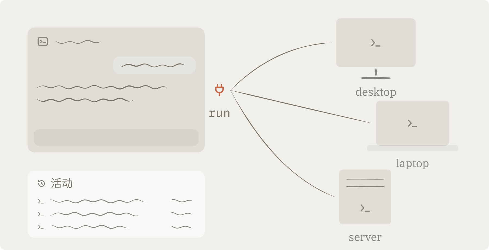
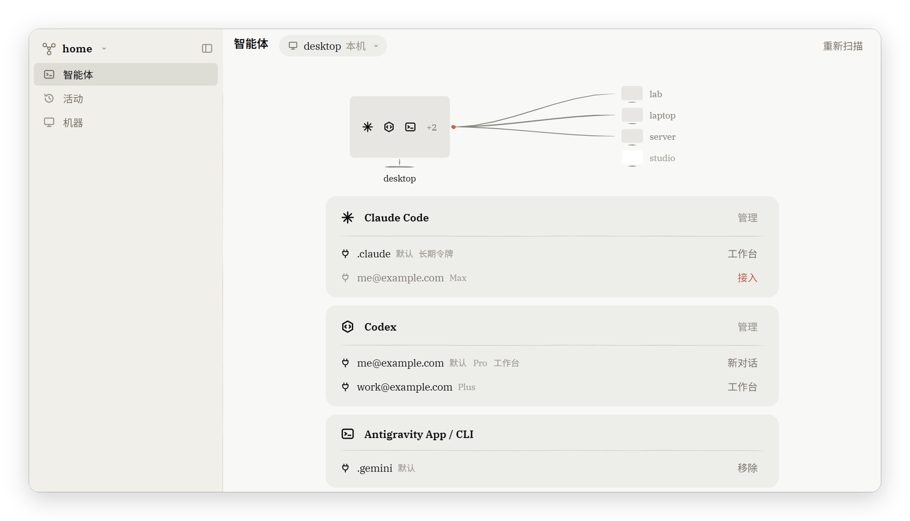
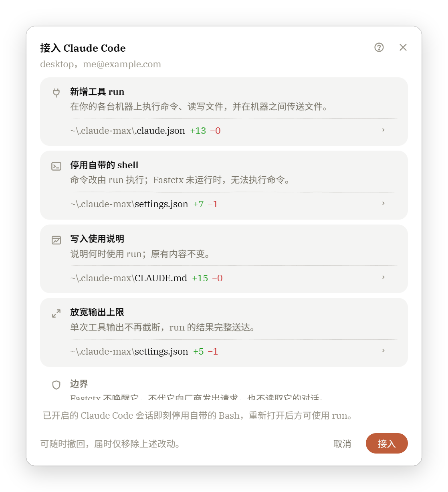
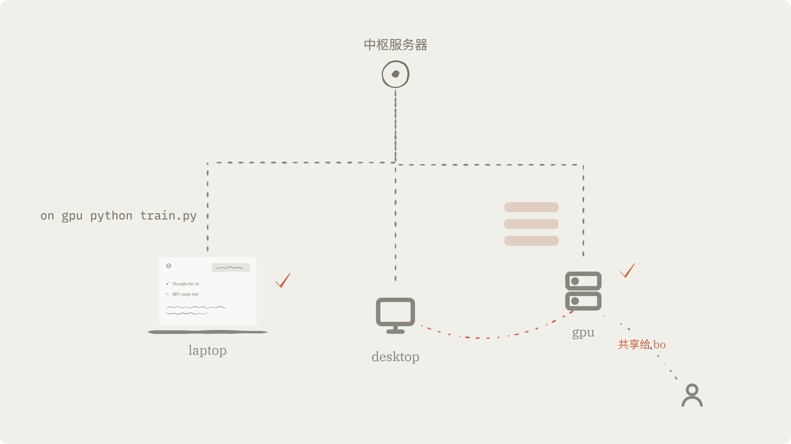
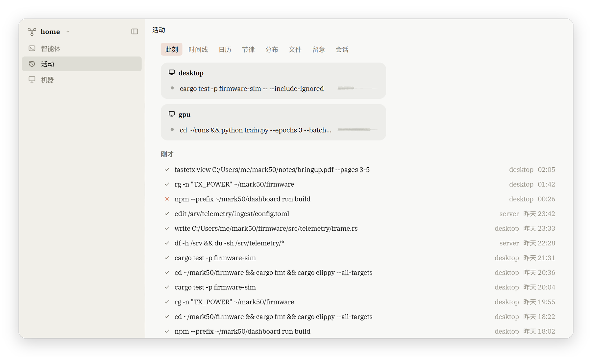
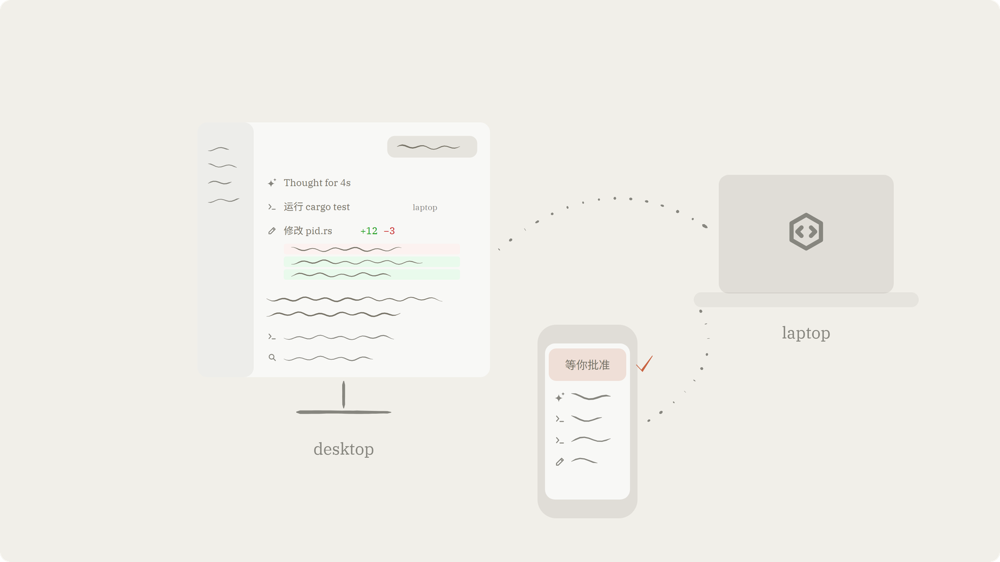

<p align="center">
  
</p>

<h1 align="center">Fastctx</h1>

<p align="center">让你已经在用的 AI 智能体，在你的每一台机器上工作。</p>

<p align="center">
  <a href="#安装">下载</a> · <a href="README.md">English</a> · <a href="LICENSE-APACHE">Apache-2.0</a>
</p>

<picture>
  <source media="(prefers-color-scheme: dark)" srcset="docs/readme/zh/hero-dark.png">
  
</picture>

## Fastctx 是什么

Fastctx 是一个 MCP 工具。把它接进你已经在用的智能体（共支持 17 款，包括 Claude Code、Codex 与 Cursor），智能体就多了一个工具 `run`：在你的任意一台机器上执行命令、查看与修改文件，在机器之间复制文件，把耗时的任务留在后台继续运行。

- 你照常在原来的智能体里工作，不用换工具，也不用改习惯。
- 你的机器经你自己的中枢服务器连成一个网络，Windows、macOS、Linux 都可以加入，不需要公网地址。
- 智能体经 Fastctx 在某台机器上做的每件事，都记在那台机器的「活动」里。
- 提供桌面应用（Windows、macOS、Linux）、安卓应用和命令行。
- 机器之间的数据只经过你自己的中枢服务器（或机器之间直连），不经过任何第三方服务器。

<picture>
  <source media="(prefers-color-scheme: dark)" srcset="docs/readme/zh/agents-dark.png">
  
</picture>

## 接入一个智能体

打开 Fastctx，它会找出这台电脑上装着的智能体和它们的登录。按下 **接入** 之前，先弹出一个窗口说明要改什么：每一项改动一张卡片，卡片下面是对应文件的 diff。

接入只做三件事：

1. **新增工具 `run`**：把 Fastctx 的 MCP 服务登记进智能体的配置文件，例如 Codex 的 `config.toml`、Claude Code 的 `.claude.json`。
2. **写入使用说明**：在智能体的全局说明文件（例如 `AGENTS.md`、`CLAUDE.md`）里写一小段，说明什么时候用 `run`。
3. **停用自带的 shell**：命令改由 `run` 执行。有 8 款智能体的自带 shell 无法停用（见下表），它们会两种都用，只有经 `run` 执行的命令记入活动。

- **移除**：只拿走 Fastctx 写入的内容，还原改过的值；文件里你自己的内容不动。
- **升级**：Fastctx 升级后，会把它写入的内容换成新版本的写法；这几处若被人改过，替换之前先把文件原样留一份。
- **边界**：Fastctx 不唤醒智能体，不代它向厂商发出请求，也不读取它的对话、额度和用量。它只读登录目录里记着的账号，用来分清一台电脑上的几个登录。

<p align="center">
  <picture>
    <source media="(prefers-color-scheme: dark)" srcset="docs/readme/zh/connect-dark.png">
    
  </picture>
</p>

| 自带的 shell | 智能体 |
|---|---|
| 停用 | Claude Code、Codex、Antigravity（App 与 CLI）、OpenCode、Qwen Code、Cline、Zed、Auggie、Devin（Desktop 与 Local） |
| 无法停用 | Cursor、GitHub Copilot CLI、Copilot（VS Code）、Roo Code（VS Code）、Kiro、Trae、Continue、Claude Desktop |

## 一个工具：`run`

`run` 接收一段 bash 脚本。每段脚本用 `on <机器名>` 写明在哪台机器上运行：

```bash
on laptop cargo test --release
```

```bash
on server <<'EOF'
cd /srv/app && tail -n 200 app.log | grep ERROR
EOF
```

`on` 也是脚本里的一条普通命令，可以放进管道、循环和条件里：

```bash
on laptop <<'RUN'
for m in desktop server; do on "$m" df -h / & done; wait
diff <(cat ~/app/app.ini) <(on server cat /srv/app/app.ini)
RUN
```

- **查看文件**：`fastctx view` 一次可以看多个文件。文本带行号；图片直接交给模型看；PDF 按页取文字或页面图像；Word、PowerPoint、Excel 取出内容。
- **修改文件**：`edit` 用 SEARCH/REPLACE 块改一处，`write` 整份写入。脚本交给 bash 之前，Fastctx 先把整段解析一遍；有一处解析不通，就一条都不运行。
- **在机器之间复制**：`fastctx copy laptop:/data/run.log server:/srv/logs/`。文件的字节不经过模型的上下文，内容相同的文件不重发。
- **长任务**：一次调用默认等 15 秒，最长 10 分钟（600 秒；写 `0` 直接转到后台）。没跑完的任务转到后台，留在那台机器上继续运行，关掉对话、合上笔记本都不影响。`fastctx w` 列出正在运行的任务，`fastctx wait` 等它结束，`fastctx stop` 停掉它。
- **写明位置**：每次回答的第一行写着它在哪台机器上运行。
- **环境**：每次调用都在目标机器上开一个全新的登录 shell，从家目录开始。Windows 上用 Git for Windows 的 bash，macOS 优先用 Homebrew 的 bash，Linux 用系统的 bash。`rg` 随 Fastctx 一起提供。

## 机器与中枢服务器

一个网络由一台中枢服务器和你的机器组成。中枢服务器认出每台设备，管着哪个账号能用哪台机器，机器之间的话经它转达。

- **中枢服务器放在哪**：可以是这台电脑，也可以在应用里经 SSH 让一台服务器来当。在那台机器上直接用终端，运行 `fastctx hub init --service` 也能建好。
- **机器怎样连上**：每台机器主动经 HTTPS 与 WebSocket 连向中枢服务器，不需要公网地址；断网、重启、休眠之后自动重新连上。
- **账号**：分超级管理员（一个中枢服务器只有一个）、成员和访客三种。
  - 一台机器可以整台共享给别的账号。
  - 一个智能体的登录也可以单独去协助别的账号，机器本身不交出去。
- **加入一台服务器**：用 `fastctx token new` 或在「机器」页生成入网码，再在 Linux 服务器上运行 `fastctx server install <入网码>`。
- **直连**：管理员可以让一台有公网地址的机器接受直连，两台机器之间的话不再经过中枢服务器。
- **安全**：中枢服务器看得见经过它的内容，要像保护最重要的那台机器一样保护它。
- **厂商请求**：智能体向厂商（例如 OpenAI、Anthropic）发出的每个请求，都直接从智能体所在的机器、经那台机器自己的网络发出。Fastctx 从不转发、代理这些请求，也不为它们建隧道。

<picture>
  <source media="(prefers-color-scheme: dark)" srcset="docs/readme/zh/network-dark.png">
  
</picture>

## 活动

每台机器都有自己的活动记录，回答一个问题：我的智能体经 Fastctx 在我的机器上做了什么。

- **记录什么**：
  - 哪段会话、哪个智能体、什么时候、在哪台机器上运行了什么命令。
  - 结果：完成、失败、被停下或失去联系，连同退出码。
  - 输出多大。
  - 改了哪些文件。经 Fastctx 的写命令与复制命令改的，直接记下；脚本里别的程序改的，在脚本进入过的 git 仓库里比对得出。
- **保留多久**：明细保留 90 天，之后折成每小时的汇总，保留一年。都存在那台机器自己的数据库里。
- **谁能看**：别的账号只看得到在你的机器上替它做的那部分，其余只有你自己看得到。

<picture>
  <source media="(prefers-color-scheme: dark)" srcset="docs/readme/zh/activity-dark.png">
  
</picture>

## 工作台（Claude Code 与 Codex）

在接入的 Claude Code 或 Codex 登录上，还可以另外打开工作台。打开之前，同样有一个窗口写明它要做的改动。

- **对话**：在 Fastctx 的桌面应用和安卓应用里与智能体对话。
- **叫醒**：智能体等着的事情发生时（例如后台任务结束），Fastctx 叫醒它接着做，你不在时也一样。
- **额度**：显示这个登录的额度与用量。
- **模型协作**：一段对话可以把局部任务交给另一个模型（例如 Claude 交给 Codex），同时进行的数量可以设置。
- **互不干扰**：你直接在 Claude Code、Codex 里开的会话不受影响。
- **随时关闭**：工作台随时可以关掉，对话和数据都留着。
- **花谁的额度**：对话花的是这个登录自己的额度。

<picture>
  <source media="(prefers-color-scheme: dark)" srcset="docs/readme/zh/workbench-dark.png">
  
</picture>

## 安装

Fastctx 1.0 目前是测试版，发布在 [GitHub Releases](https://github.com/yc-duan/fastctx/releases) 的预发布里。npm 上的 `fastctx`（与 `codex-fastctx`）仍是 `0.2.6`（早先的一组工具），1.0 不发布到 npm。

| 平台 | 桌面与手机应用 | 命令行 |
|---|---|---|
| Windows x64 | `Fastctx_<版本>_x64-setup.exe` | `fastctx-x86_64-pc-windows-msvc.zip` |
| Windows ARM64 | `Fastctx_<版本>_arm64-setup.exe` | — |
| macOS（Apple 芯片） | `Fastctx_<版本>_aarch64.dmg` | `fastctx-aarch64-apple-darwin.tar.gz` |
| macOS（Intel） | `Fastctx_<版本>_x64.dmg` | `fastctx-x86_64-apple-darwin.tar.gz` |
| Linux x86_64 | `.AppImage`、`.deb` | `fastctx-x86_64-unknown-linux-gnu.tar.gz` |
| Linux ARM64 | — | `fastctx-aarch64-unknown-linux-gnu.tar.gz` |
| Android | `Fastctx_<版本>_universal.apk` | — |

- **校验**：每个版本都附带 `SHA256SUMS`。
- **Windows**：需要先装 Git for Windows（`run` 用它的 bash）。
- **macOS**：安装包没有经过苹果公证。第一次打开时，到 **系统设置 → 隐私与安全性** 里点 **仍要打开**。
- **第一次打开**：直接进入「智能体」页，一台电脑就能用。要连起多台机器，到「机器」页新建网络或加入网络。
- **更新**：桌面应用自动更新。命令行运行 `fastctx update`（加 `--check` 只检查有没有新版，加 `--auto` 设为自动更新）。

## 命令行

| 命令 | 作用 |
|---|---|
| `fastctx` | 在终端里打开文字界面 |
| `fastctx apply` / `fastctx unapply` | 为这台电脑上的 Codex、Claude Code 接入或移除 Fastctx |
| `fastctx login` | 把这台电脑登录到中枢服务器上的一个账号 |
| `fastctx hub init --service` | 在这台机器上建中枢服务器，并作为系统服务运行 |
| `fastctx token new` | 生成入网码，让别的设备加入 |
| `fastctx server install <入网码>` | 在 Linux 服务器上安装 Fastctx 并加入网络 |
| `fastctx nodes` | 列出机器：哪些在线、各是什么样 |
| `fastctx share` / `fastctx assist` | 共享一台机器 / 让一个智能体的登录协助别的账号 |
| `fastctx update` | 更新到本通道的最新版 |
| `fastctx uninstall` | 预览或执行卸载 |

## 使用条款

Codex 与 Claude Code 各自带着厂商的使用条款，规定谁可以使用一份订阅、怎样使用。Fastctx 只启动官方程序，不做任何修改，登录的是在那台机器上登录的人；智能体向厂商发出的每个请求，都从它所在的机器、经那台机器自己的网络发出，Fastctx 从不转发、代理这些请求，也不为它们建隧道。把一台机器上的智能体借给别的账号是否符合这些条款，由你自己判断；我们请每一位使用 Fastctx 的人遵守它们。

## 状态与许可

- Fastctx 1.0 处于测试阶段。macOS 与 ARM64 上的系统服务还没有在真机上验证过。
- 以 Apache License 2.0 发布，见 [`LICENSE-APACHE`](LICENSE-APACHE) 与 [`NOTICE`](NOTICE)；第三方组件的许可见 [`THIRD_PARTY_LICENSES.md`](dist/THIRD_PARTY_LICENSES.md)。
- 感谢 linux.do 社区。
